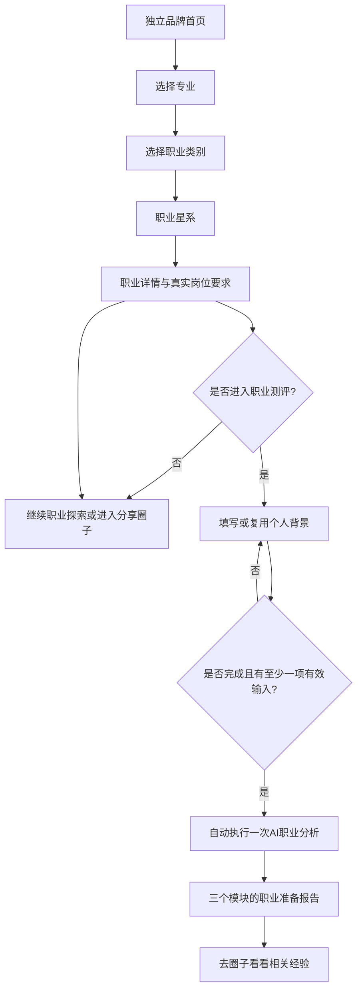
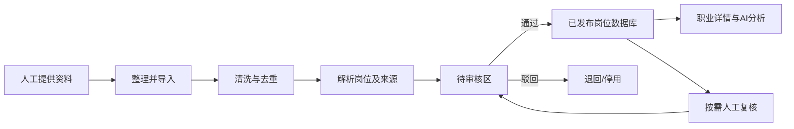

# 去向（QUXIANG）产品需求文档 PRD V2.0

> **文档状态**：需求基线（四轮产品访谈及最终规则确认）  
> **版本**：V2.0  
> **制定日期**：2026-11-22  
> **文档用途**：产品、设计、前后端、AI Coding、测试及内容维护的共同依据  
> **实施原则**：基于现有「去向」网站增量改版；先审查现有代码、路由、组件、数据及登录机制，再决定实现细节。  
> **事实边界**：本文依据产品需求访谈编写，尚未审查网站源码或生产数据库。涉及现有实现的描述是产品历史/需求说明，并非代码审计结论。

---

## 0. 决策状态与冲突检查

### 0.1 已确认、不可擅自更改的决策

1. **范围**：本轮完整建设新闻传播学相关11个职业方向；其他现有专业及其功能保留，原则上不在本轮重构。
2. **信息架构**：三个一级入口——**职业探索 / 分享圈子 / 我的**；独立品牌首页保留。
3. **探索路径**：选择专业 → 选择职业类别 → 职业星系 → 职业详情；职业星系原有视觉及交互予以保留。
4. **测评性质**：原职业定向选择题测评在本轮11个职业中由**个人背景分析**取代；测评完全自愿，职业详情和社区浏览不以测评为前提。
5. **测评与报告是一项功能**：用户选择测评，填写至少一项有效课程、技能或经历，并在结束输入后触发**一次自动报告生成**；不得在完成填写时再要求做一次独立的“是否生成报告”决定。
6. **个人信息**：结构化字段与自由描述并用；课程、比赛与项目、实习与社会实践、作品与作品集、已掌握技能及工具；名称为主，任务或成果选填。
7. **报告**：固定为「大学知识与经历迁移」「岗位要求与补充学习」「职业准备概览：加权证据覆盖率条形图 + 三条行动建议」。无 AI 动画人物画像。
8. **AI 与职业资料**：真实岗位要求数据库约束 AI 的识别、映射及解释；使用真实 AI 服务，失败时明确告知，不得伪装成功或虚构报告。
9. **招聘数据**：使用用户或维护人员人工提供的资料，保留出处与证据标记，**审核后发布**。
10. **社区**：独立入口；访客可浏览；在校生发求助帖、已就业分享者发经验帖；评论/回复、点赞、收藏、筛选/搜索、举报、私信；先发布后审核，配合自动风险识别、举报及管理员处理；支持匿名发帖与自报“未认证”就业身份。
11. **账号**：优先复用已有登录方式；访客可暂存并分析，登录后可保存个人背景及每职业最新一份报告。
12. **设计**：明亮杂志式视觉为主，减少3D和过量动效；保留星系交互；功能、数据、交互、安全及端到端流程均需验收。

### 0.2 冲突消解规则

| 容易混淆的需求 | 统一解释 |
|---|---|
| 自愿测评 vs 自动生成 | 自愿**进入测评**；进入后用户明确完成填写，系统自动生成一次。进入页面、输入到一半或退出均不触发。 |
| 测评与报告是否独立 | **不独立**。同一流程中的输入与分析结果，不设置第二套报告功能。 |
| 访客免登录 vs 报告保存 | 访客可分析、临时保存于本地；跨设备、账号持久保存需要登录及同步授权。 |
| 覆盖率百分比 vs 能力评分 | 百分比代表**所提供证据对选定岗位要求的覆盖程度**，并非能力、录用可能性或人格分数。 |
| 人工资料 vs 审核发布 | 资料人工导入后先进入候选区，经过归纳、去重和内容审核后才能成为对外展示及分析依据。 |
| 先发布后审核 vs 社区安全 | 正常内容可发布后进入审核；高风险内容可在公开前拦截/暂时隐藏，管理员可撤回。 |
| 匿名发布 vs 违规追责 | 公开对普通用户匿名；系统内部仍保留最小必要的作者关联，供管理本人内容与安全审核。 |

### 0.3 实施前待核验（不是阻碍 PRD 定稿的产品冲突）

- 实际前后端技术栈、目录结构、已有路由及职业星系组件接口。
- 现有专业、职业、分类的真实 ID、字段与映射；11个目标方向与现有数据的一一对应关系。
- 现有登录、身份标识、数据库与持久化能力。
- 招聘源是否提供许可的数据接口、站点规则及具体可合法稳定使用的字段。
- AI 服务商、运行成本、密钥配置、可用性与数据处理约束。
- 当前部署环境、管理员入口、备份与监控能力。

上述事项应以代码审计/实际接口核验形成记录，不得仅凭本文猜测框架名称、表名、路径或现有功能完成状态。

---

## 1. 产品概述

### 1.1 产品定位

**去向**是一款面向大学生的专业探索与职业准备平台，连接大学所学内容、真实招聘要求及从业者经验，帮助学生回答：

1. 我的专业可以走向哪些职业？
2. 我在大学课程和实践中已积累了哪些与目标岗位相关的准备？
3. 对照企业要求，我还需要学习和实践什么？

平台提供**职业信息与准备建议，不保证就业、不替代企业录用标准或专业资质审核**。

### 1.2 目标用户及角色

| 用户 | 主要目标 | 权限概述 |
|---|---|---|
| 访客 | 浏览职业、招聘信息、经验帖；试用职业测评 | 免登录浏览与临时测评；不可进行需要账号的写入/私信操作 |
| 在校生 | 发现职业、保存经历与分析、提问交流 | 登录后管理个人资料、收藏、求助帖、评论与互动 |
| 已就业分享者 | 讲述求职与工作经历、答疑 | 登录后发布经验帖、参与互动；就业状态自报、未认证 |
| 管理员 | 核实内容、治理社区与岗位资料 | 审核、下架、举报处理、账号处置、数据发布等受控操作 |

一人一账号；“在校生/已就业分享者”是账号声明的社区角色，可在允许的规则下变更；管理员权限独立授权、不能由用户自行选择获得。

### 1.3 范围

本次针对新闻传播学11个职业方向完善内容和新功能，目标职业清单（以最终数据映射审计为准）：

1. 记者；2. 编辑；3. 新媒体运营；4. 内容运营；5. 用户运营；6. 产品经理；7. 品牌策划；8. 市场营销；9. 公关；10. 视频编导；11. 文案策划。

**原有其他专业不得删除或错误映射；未适配新版分析的旧内容须正常访问，并清晰区分功能可用状态。** 不得把这11项作为全站仅有专业/职业而清空其余数据。

### 1.4 不在本轮范围

- 为全站所有专业重建岗位和分析数据库。
- 恢复11个目标职业原选择题测评或 AI 动画职业角色。
- 自动投递简历、就业录用预测、付费课程商城、自动爬取用户私有账号信息。
- 未经证实的“就业认证”、自动生成虚构毕业生经历。

---

## 2. 信息架构与页面

### 2.1 一级结构

- **品牌首页**：独立品牌展示页，标题 **「寻找你的职业。」**；清楚的开始探索 CTA；可进入职业探索。品牌首页不与职业选择内容混为长页面。
- **职业探索**：专业选择 → 职业类别 → 职业星系 → 职业详情 → 可选职业测评/报告。
- **分享圈子**：独立社区首页、搜索筛选、帖子详情、发布和互动、消息请求/私信。
- **我的**：登录/账号资料、个人背景档案、每个职业最新报告、收藏内容、我的帖子/消息和隐私设置。
- **管理员工作台**：受控内部页面，不作为普通用户一级导航。

### 2.2 页面及功能对照（示意页面 ID；真实路由待审计）

| 页面 ID | 页面 | 核心内容 | 登录要求 |
|---|---|---|---|
| P01 | 品牌首页 | 大标题、品牌视觉、开始探索 | 否 |
| P02 | 选择专业 | 现有专业数据及选中状态 | 否 |
| P03 | 选择职业类别 | 当前专业对应类别及返回导航 | 否 |
| P04 | 职业星系 | 原光点/细线/悬停/聚焦/点击交互 | 否 |
| P05 | 职业详情 | 职责、岗位差异、招聘条件、来源、测评邀请、圈子关联 | 否 |
| P06 | 个人背景输入 | 结构化字段、自由描述、完成填写、退出 | 否 |
| P07 | 职业准备分析 | 固定三个结果模块、说明、保存与分享圈子入口 | 否（账号持久保存需登录） |
| P08 | 分享圈子首页 | 经验/求助内容、职业标签、搜索筛选 | 否 |
| P09 | 帖子详情与发布 | 原文、互动、匿名选项、举报 | 阅读否；写入是 |
| P10 | 私信与消息请求 | 会话请求、接受/拒绝、屏蔽、举报 | 是 |
| P11 | 我的 | 背景、最新报告、收藏、内容管理、登录设置 | 账号数据需登录 |
| P12 | 管理后台 | 岗位审核、帖子/举报/风险、权限管理 | 管理员 |

路由命名由开发时结合已有项目调整，**不得为了匹配示意 ID 全量迁移既有路由**。

### 2.3 核心流程

**用户不需要测评即可浏览详情、招聘要求与圈子；不得把社区或职业浏览放在测评/报告之后作为锁定步骤。**

---

## 3. 功能需求：职业探索

### EXP-01 专业选择及职业类别【P0】

- 复用现有专业和类别数据及映射关系；用户选择专业后进入其对应职业类别，再进入职业星系。
- 本轮全面完善新闻传播学的11个职业；其他现有专业页面/路径原则上保持可用。
- 显示所选路径、返回上一层及返回首页方式。
- 纠正已发现的“汉语言文学与新闻传播细分方向重复”等**数据映射层错误**，而不是仅在页面上遮盖错误。
- 类别下无职业时展示明确空状态，不使用错误职业数据兜底。

**验收**：11个职业能从新闻传播学对应路径正确访问；切换专业不串数据；其他现有专业映射未回归性损坏。

### EXP-02 职业星系【P0，保留优先】

- 保留当前职业星球光点、细线连接、微闪、鼠标悬停聚焦、相关路径高亮、点击展开/跳转的主要体验。
- 不因视觉改版重新设计成普通卡片列表。
- 针对键盘、触屏与小屏提供等效访问机制和必要响应式适配，保持职业数据一致。
- 星系仅消费有效职业关系数据，不自行生成职业名称或连接。

**验收**：现有核心动效和操作行为保持；11个目标职业可准确点选，触屏和键盘有可用的替代交互。

### EXP-03 职业详情【P0】

每个职业至少展示：

1. 职业定位与典型工作任务、日常工作场景。
2. 常见岗位类型以及不同企业/组织类型之间的职责差异。
3. 来自真实招聘记录的岗位要求：必要条件、优先条件、技能/工具、作品/项目、实习/资质（仅在对应岗位确实要求时出现）。
4. 来源企业/平台、来源链接、岗位发布时间（如可得）、抓取/核实日期、状态说明；标明历史样本与当前招聘的区别。
5. 相关岗位样本筛选（如企业类型/岗位类型，依可用数据确定）。
6. 非强制的「开始职业测评」入口、「暂时跳过/继续浏览」路径；可前往相关职业标签下的圈子帖子。

**验收**：无岗位样本时说明“暂无已审核的招聘样本”，不得编造要求；详情浏览不强迫登录或测评。

---

## 4. 功能需求：个人背景与职业测评

### ASSESS-01 入口、授权与触发【P0】

- 入口可出现在职业详情，并可由「我的」选择目标职业再进入；入口位置以现有代码和页面审查为基础确认。
- **用户点击开始测评是自愿选择；**后续填表是该测评内部步骤，而非独立报告产品。
- 必填业务前提：存在有效目标职业，且至少有**一项非空、可识别的有效课程、技能或经历**。
- 用户可离开输入页面，不触发分析；输入过程不逐字调用 AI。
- **“完成输入”事件**：用户点击「完成填写」结束编辑（这是输入流程的完成动作，**不是第二次“是否生成报告”确认**）；系统立即校验输入并自动发起**一次**分析，随后展示结果。无效时提示需补充信息。
- 自动分析请求期间展示进度及禁止重复提交；后台设置幂等请求标识，防止多次扣费/重复记录。
- AI 请求失败时展示真实失败状态及重试，不生成默认分数或伪造报告。

> 实现说明：用“完成填写”明确定义何时结束输入，兼顾“输入完成后自动生成一次”与不在输入中途反复触发。若现有网站已有清晰的“完成编辑”行为，应优先复用其交互。

### ASSESS-02 个人背景字段【P0】

| 组别 | 建议字段 | 必填策略 |
|---|---|---|
| 大学课程 | 名称、可选学习内容/作业/项目说明 | 全组可不填；填写一条时名称不能为空 |
| 比赛与项目 | 名称、角色、任务、成果/链接、时间（选填） | 全组可不填；有条目时名称不能为空 |
| 实习与社会实践 | 机构（可匿名化描述）、岗位/项目、任务、成果、时间（选填） | 全组可不填；有条目时至少有可识别经历名称或岗位 |
| 个人作品与作品集 | 作品名称、类型、个人贡献、链接/说明 | 全组可不填；有条目时至少填写名称 |
| 技能与工具 | 名称、使用情境/佐证（选填） | 全组可不填；名称不能为空 |
| 自由补充 | 个人背景描述、特别说明 | 选填；不替代全部结构化约束 |

- 用户可增删多个条目；不要求经历数量或一定具有实习经验。
- 不以用户的自我声明或课程名称直接认定“熟练掌握”。
- 适当的字段长度、链接校验、敏感信息警示、保存失败反馈由实现阶段明确，并纳入验收。

### ASSESS-03 AI 分析业务逻辑【P0】

输入：用户选择的目标职业、结构化及自由背景、**已审核且允许用作分析依据**的岗位要求与来源、必要的解释规则。

分析步骤（逻辑要求，不指定某种模型）：

1. 读取用户明确填写的课程、项目、实习、技能等事实；区分“用户陈述”“可推断的学习基础”“需核实的实际掌握程度”。
2. 从该职业真实岗位要求中提取结构化任务、技能、资格及作品要求；保留出处与企业/岗位类型。
3. 生成“经历 → 潜在学习/实践基础 → 具体岗位任务”的迁移关联及理由。
4. 将个人可提供的证据映射到岗位要求；对未覆盖要求优先判断为**“尚缺可验证证据”**，而不是断言用户缺乏能力。
5. 推荐优先补充项，关联要求出处，并生成可执行的学习/实践任务。
6. 按确定性算法计算每一准备类别的加权**证据覆盖率**；AI 负责证据关联及解释，**不能自行臆造最终百分比**。
7. 生成三条与待补充项对应、可操作且不相互重复的下一步建议。

**不可接受**：把岗位要求来源虚构为某企业招聘、把课程自动判定为精通、编造用户作品/实习、输出就业成功率、使用未经核验招聘作为明确要求。

### ASSESS-04 报告结构【P0】

**模块一：大学知识与经历迁移**

- 按用户课程与经历条目组织，每项说明可迁移的学习/实践基础、对应的具体岗位任务以及关联依据。
- 课程学习与实践成果证据应有强度区别；关联不足时如实说明。
- 不在此模块重复输出全部待学内容。

**模块二：岗位要求与补充学习**

- 按真实岗位要求组织，显示待补充的技能/知识/工具/作品或实践、为何重要、对应来源、现有证据状态、具体准备方式。
- 区分必要、优先、建议的要求；优先显示3—5项最重要内容，并提供查看其他要求的方式。
- “用户未提供证据”不等于“用户能力不足”；避免不切实际的统一标准。

**模块三：职业准备概览**

- 按岗位能力类别展示**加权证据覆盖率百分比的横向条形图**，包含状态文案、分母与权重依据入口。
- 给出**恰好三条**与模块二相关的优先行动建议（当基础资料极少时，建议可以是补充资料/核实经历，而非虚构训练任务）。
- 清楚标注：这是岗位要求**证据覆盖度**，不是职业胜任力考试、职业匹配概率或录用预测。
- 不出现旧选择题分数或 AI 动画职业画像。

报告顶部可有简短摘要及目标职业名称，底部提供相关分享圈子入口；摘要、CTA 不计为额外分析模块。

### ASSESS-05 覆盖率的可解释计算规则【P0】

**计算对象**：某一目标职业、特定职业要求样本集、特定背景资料版本下的“招聘要求证据覆盖度”。

1. 对已审核招聘要求进行去重、同义归并与类别化；必须能追溯到一条或多条真实岗位记录。
2. 对要求标注重要性：**必要（建议默认权重3）/优先（2）/一般建议（1）**；这是待验证的实施默认值，若原始岗位未区分重要性，需记录人工规则，不由 AI 无依据判定为“必要”。
3. 对用户证据标注：**有具体直接证据 1 / 仅有部分关联或间接证据 0.5 / 尚无证据 0**。若 AI 判断不确定，需降低信心或提示补充材料；不能把推断当作已证明的技能。
4. 类别覆盖率 = `Σ(要求重要性权重 × 证据系数) / Σ(同类别全部可用要求权重) × 100%`；如需总体百分比，采用相同权重口径求和，不将各类别简单平均。
5. 数值展示到整数百分比，支持点击查看要求条目、证据映射、权重及来源；保存**计算规则版本号、样本集版本、用户背景版本**，便于复核。
6. 若某类别缺少足够已审核岗位要求，则显示“岗位依据不足，暂不计算”，不得输出 `0%` 假装用户毫无准备；报告可以仍有文字性分析，但要标注依据限制。
7. 若用户仅填写一项信息，允许生成**有限证据报告**，突出信息有限及未提供证据的解释；禁止把低覆盖率解释为低能力。

> 权重 `3/2/1` 与证据系数 `1/0.5/0` 属于为使PRD可实施而提出的**待校验默认规则**，不是访谈中已逐项确定的数值。开发前由产品负责人与内容审核者确认，并可在后台配置及版本化；**不得**在 UI 中宣称该算法经过科学效度验证。

### ASSESS-06 保存与更新【P0】

- 访客在当前设备/浏览器本地临时保存背景与分析状态；提醒用户此类数据可能因清理浏览器而丢失。不得把本地存储当作加密保险库。
- 登录后可选择将本地资料同步到账号；避免无授权跨账号覆盖。
- 账号下保存最新个人背景，以及**每个职业最新一份报告**；重新分析同职业可覆盖旧报告，必要审计信息由后端按安全要求保存。
- 资料修改后，已存报告标注对应的资料版本；不在用户编辑过程中反复自动重新生成报告。用户再次进入测评并完成填写时更新。
- 用户能够查看/编辑/删除自己保存的背景及报告；不得由普通用户读取他人个人背景。

---

## 5. 功能需求：分享圈子

### COMM-01 社区定位与内容【P0】

- 与职业探索并列的**独立一级入口**；免登录可浏览。
- 内容围绕新闻传播学11个职业组织，不强制发帖人的大学专业必须是新闻传播学。
- **已就业分享者**发布职业经验帖（职业工作、求职、在校准备、转型经历等）；**在校生**发布求助帖。发布身份依据账号自报状态，不默认为认证事实。
- 帖子关联一个或多个有效职业标签；详情页及报告页可跳转到相应职业内容。
- 明确区分作者个人经历与企业官方招聘要求；不得把社区观点直接充当岗位事实来源。

### COMM-02 账号与角色【P0】

- 访客：可浏览、筛选和搜索公开帖子及评论；不能发布、评论、点赞、收藏、举报或私信（举报若允许访客提交则须另定反滥用机制；本版本默认登录举报）。
- 在校生：登录后可发布求助帖、评论/回复、点赞、收藏、举报、发送私信请求、管理自己的内容。
- 已就业分享者：登录后可发布经验帖并进行上述互动；就业信息**用户自报，公开显示“未认证”**，无平台已核实的暗示。
- 管理员：可按授权审核帖子、查看举报、隐藏/删除内容、限制账号、维护数据和审核日志；管理操作留痕。

### COMM-03 发布与匿名【P0】

- 帖子包括：帖子类型（经验/求助）、标题、正文、关联职业、可选图片/链接（支持格式和限制以安全评估为准）、作者、发布时间和审核状态。
- 支持“匿名发布”：前台不显示真实姓名、账号昵称、可跳转个人主页或可反查作者的公开 ID；作者在本人中心仍可管理自己的匿名帖子。
- 管理后台保留权限受控的作者关联以处理投诉，不公开匿名关联。
- 在投稿界面提醒不要泄露本人或他人的联系方式、证件、未获授权的工作资料。
- 正常帖先发布后审查；明显违规或高风险内容可在发布前自动阻断/隐藏，之后管理员复核。

### COMM-04 互动、搜索与收藏【P0】

- 评论与回复：支持按帖查看、作者删除自己的内容、管理员处置，防垃圾刷屏。
- 点赞与收藏：登录写入，幂等，允许取消；收藏在「我的」中可查。
- 搜索与筛选：支持关键词、11个职业标签、经验/求助类型；清晰显示无结果状态。
- 举报：登录用户可对帖、评论、私信提交原因，进入管理队列；避免举报回执泄露举报者身份。
- 内容删除/下架后，搜索、列表、链接详情必须同步表现正确状态。

### COMM-05 私信【P0】

- 登录用户可向另一用户发送**陌生人消息请求**，对方接受前不可直接建立持续聊天；接受后才开放正常会话。
- 支持拒绝请求、屏蔽用户、举报会话、删除本人会话视图、消息发送频率限制和基础反骚扰检测。
- **匿名帖不提供绕过匿名的直接“联系作者”入口**；可否通过匿名帖发起消息需以不会暴露作者身份为前提，本版默认不开放。
- 举报私信内容只允许授权审核人员在必要范围内访问；不将私信公开展示或用于生成职业报告。

### COMM-06 内容治理【P0】

- 自动过滤明显违规内容及风险信号、用户举报、管理员人工审核三者结合；普通内容可先发布后审核。
- 风险分级：高风险先拦截/隐藏，低风险可先公开后抽查；处理记录包含原因、状态、操作者、时间。
- 管理员可隐藏、恢复、删除、限制发言或封禁；应提供申诉或反馈渠道。
- 防止灌水、重复发帖、机器人刷赞、垃圾私信和恶意链接；遵循最少必要的数据收集原则。

---

## 6. 功能需求：「我的」及账户

### PROFILE-01 账号【P0】

- 审查现有认证/登录系统，优先复用；未审查前不指定邮箱、手机号或第三方身份系统作为强制方案。
- 个人档案与公开社区身份分离；访客浏览无需注册。
- 账号需具有安全退出、会话有效期、基本账户管理及身份权限检查。

### PROFILE-02 用户中心【P0】

- 个人背景档案：课程、项目、实习、作品、技能的查看、编辑、删除。
- 职业报告：按职业查看**最新一份**及其生成时间、背景版本、岗位资料基准时间；支持对同一职业再次测评更新。
- 我的收藏：职业与圈子帖（实际是否已有职业收藏能力，开发前核验）。
- 我的内容：发布的经验/求助帖、匿名帖（仅本人可见作者关联）、评论、收到的消息请求与私信。
- 隐私设置：公开昵称、可公开的就业信息、阻止消息、注销/删除个人信息流程。

### PROFILE-03 数据保护【P0】

- 仅收集完成产品功能必要的信息；作品链接、实习经历和自述属于用户提供的可能敏感信息，应避免在公开页自动曝光。
- 服务端 AI 请求仅传分析所需字段；对日志、监控、错误上报进行个人数据脱敏。
- 默认不公开个人背景、报告、私信；账号权限与数据归属由服务端验证。
- 支持删除账号所持个人背景、报告和个人内容的合理请求，并说明法定或安全目的下的例外留存。

---

## 7. 招聘资料人工导入、审核和版本化

### JOB-01 数据来源【P0】

- 来源类型包含**企业官方招聘网站**和**符合可访问及使用条件的招聘平台**。
- 用户或维护人员按需提供资料，保留原始链接、附件或文档位置。
- 为不同来源保存可靠性标签；官方来源通常优于无明确出处的聚合转述，按资料注明时间、岗位和内容的已知边界。此次用户提供的资料无需独立验证来源。

### JOB-02 岗位数据字段【P0】

建议样本元数据字段（最终字段名由实际 schema 决定）。通用要求以职业为单位归纳，不含特定企业、行业或岗位门槛：

`job_id`、`career_id`、`organization_name`、`organization_type`、`job_title`、`job_category`、`location`（如公开）、`recruitment_type`（实习/校招/社招等）、`responsibilities`、`requirements`、`required_qualifications`、`preferred_qualifications`、`skills_tools`、`portfolio_requirements`、`source_type`、`source_url`、`published_at`（若可得）、`collected_at`、`verified_at`、`posting_status`、`review_status`、`data_version`。

- 校招、实习和社招不得混合成一种无区别的“入门要求”。
- 必须区分**招聘样本**与“当前正在招人”；过期样本可供职业认知参考，但不能标示为有效开放岗位。

### JOB-03 人工导入与审核流水线【P0】

- 维护人员按需补充资料、提交更正或标记失效。
- 岗位内容的新增、修改、撤销均先进入审核队列；审核通过才更新对外职业数据库版本。
- 记录导入异常、重复、状态变化和审核轨迹；支持管理员手动纠错及来源停用。
- 人工更新失败时保留上次已发布数据并标明日期与历史状态，不以空值/AI 推测覆盖可靠信息。

### JOB-04 职业数据库与 AI 引用【P0】

- 职业详情及分析只引用**已发布并已审核**的数据版本。
- 每条可展示岗位要求应可回溯到资料出处、批次及已知时间信息。
- AI 输出引用具体要求 ID；不能以模型常识或检索猜测替代明确的岗位来源。
- 对11个职业建立数据覆盖情况检查，不足时给出“数据样本不足”状态，禁止用其他职业招聘要求填补。

---

## 8. 视觉规范与交互体验

### UI-01 总体风格【P0】

- 以**明亮、高对比度、有留白的现代编辑/杂志式设计**为主，减少过多 3D 插画与炫技动效。
- 主要视觉基调建议沿用此前已确定的品牌参考色（以设计审查为准）：亮黄 `#FFE45C`、鲜蓝 `#72C7FF`、珊瑚橙 `#FF9278`、浅紫 `#C9B5FF`、薄荷绿 `#A8EBCB`、暖米色 `#FFF4DC`、白色 `#FFFFFF`、深黑 `#111111`。
- 首页标题「寻找你的职业。」为主要视觉焦点；职业插画可以采用少量鲜明编辑式元素，不要求全站 Soft 3D。
- 各模块建立一致的排版网格、字号层级、按钮、表单、卡片和色彩语义；不允许全部页面都靠同一类同质化卡片堆叠。

### UI-02 分页与导航【P0】

- 品牌首页与专业选择**真正分离**，使用清晰的页面跳转；不要把所有功能塞进一个长滚动页面。
- 不同页面有明确返回、当前位置与下一步操作；支持浏览职业后比较其他职业。
- 通过 CTA/导航访问三个一级模块；职业详情与圈子帖子之间有上下文关联。

### UI-03 动效与可访问性【P0】

- **职业星系**：保留微闪、连线、悬停聚焦、相关路径高亮和点击展开；其他页面仅在有助于反馈/导航时使用轻量动效。
- 桌面常见分辨率下内容不被固定底栏遮挡；移动端必要时允许滚动，保持按钮和输入可达。
- 按钮可键盘操作、表单有可识别标签、颜色对比充分、错误提示可理解；对减少动态效果的系统偏好提供合适退化体验。
- 职业准备百分比图表同时提供文字状态和依据，不仅用颜色编码信息。

---

## 9. 数据实体及关联（概念级，不强制实现技术）

| 实体 | 关键关系 |
|---|---|
| Major（专业） | 包含多个职业类别；旧专业与原 ID 保持兼容 |
| CareerCategory（职业类别） | 隶属专业，关联职业星系中可见的职业 |
| Career（职业） | 归属一个或多个分类、关联岗位样本、圈子标签与个人报告 |
| JobPosting（招聘样本） | 关联职业、来源、组织、发布日期、审查状态 |
| JobRequirement（岗位要求） | 关联样本与类别、要求重要性、可追溯引用 |
| User / Profile（用户及档案） | 保存角色、公开资料与私有个人背景 |
| BackgroundEntry（背景条目） | 关联用户，按课程/经历/技能/作品类型组织 |
| AssessmentReport（最新报告） | 关联用户+职业+背景版本+岗位数据版本，职业维度保留最新一份 |
| RequirementEvidence（要求—用户证据映射） | 关联报告、岗位要求、背景条目、证据系数与解释 |
| Post / Comment（帖子与评论） | 关联作者、职业标签、匿名状态及审核状态 |
| Reaction / Bookmark（互动与收藏） | 关联用户与内容，避免重复写入 |
| MessageRequest / Message（消息请求和私信） | 关联两名用户、请求状态、会话权限与举报记录 |
| Report / ModerationAction（举报与管理处置） | 记录目标、原因、处理状态、管理员审计 |

实际表结构应适配现有系统；以上为概念级数据模型，可作为后续 `DATA_MODEL.md` 的基础。

---

## 10. 权限与安全矩阵

| 操作 | 访客 | 在校生 | 已就业分享者 | 管理员 |
|---|---:|---:|---:|---:|
| 浏览职业、岗位要求、公开帖子 | ✓ | ✓ | ✓ | ✓ |
| 临时填写背景并测评 | ✓ | ✓ | ✓ | ✓ |
| 将背景/报告保存到账号 | — | ✓ | ✓ | ✓（仅自己） |
| 发求助帖 | — | ✓ | 按角色规则 | 按角色规则 |
| 发经验帖 | — | 按角色规则 | ✓ | 按角色规则 |
| 评论、点赞、收藏、举报 | — | ✓ | ✓ | ✓ |
| 私信请求、接受/拒绝、屏蔽 | — | ✓ | ✓ | ✓ |
| 修改/删除他人内容 | — | — | — | ✓（审计留痕） |
| 审核岗位、发布招聘数据 | — | — | — | ✓ |
| 读取他人未公开的个人背景/私信 | — | — | — | 仅合规授权的极有限管理场景 |

原则：权限按服务端实际验证；UI 按钮隐藏不等于授权校验；未认证就业状态不得伪装成认证身份。

---

## 11. 异常状态与业务边界

| 场景 | 必须处理的行为 |
|---|---|
| 用户未选择职业便进入测评 | 引导先选择目标职业，保留已填写资料（如存在） |
| 输入为空或只有无意义字符 | 不能生成；提示至少填写一项有效课程、技能或经历 |
| 用户中途退出背景输入 | 不触发 AI；尽量保留本地未完成输入 |
| AI 超时/错误/返回格式不合法 | 显示明确错误和重试；不生成假报告或假覆盖率 |
| 招聘记录不足或尚未审核 | 展示数据不足；不使用其他职业数据兜底，不给无根据的百分比 |
| 同一职业职位条件差异较大 | 明确招聘类型/企业类型，报告说明所依据的样本范围 |
| 本地访客数据清除 | 允许数据丢失的事实提示；不得承诺跨设备保存 |
| 访客尝试发帖/点赞/收藏/私信 | 引导登录并尽量保留操作上下文 |
| 匿名帖收到私信请求 | 不公开作者身份；默认禁止通过匿名帖直连作者 |
| 用户收到骚扰私信或垃圾内容 | 可拒绝请求、屏蔽、举报；可由管理员处置 |
| 人工维护批次不完整 | 退回并记录，继续提供已有已审核版本 |
| 已发布岗位后来过期 | 明确历史样本状态，进入更新审核，不显示“仍在招聘” |
| 用户删除个人档案 | 关联报告按约定删除/失效，不得继续引用被删除的用户私有证据 |

---

## 12. 非功能性需求

### NFR-01 性能与稳定性

- 职业浏览、星系动画、表单编辑、社区列表应有可用的加载/空态与错误恢复；不因 AI 或爬取服务异常使职业浏览不可用。
- AI 分析使用异步请求/任务状态展示；控制重复请求与并发成本。具体延迟/成功率目标须以现有部署环境基线和实测数据设定。
- 记录人工导入失败及审核操作，审核流程与前台展示解耦。

### NFR-02 隐私及安全

- API 密钥服务端保存；客户端不暴露 AI 或数据库凭证。
- 个人背景/报告/私信默认私密，按最小权限读取和写入；支持账号身份校验及审计。
- 文本输出防 XSS/注入；用户上传或链接做好安全校验；匿名身份不应在页面数据或可公开 API 中泄露。
- AI 仅将必要个人资料传给服务商；明示处理目的，避免在调试日志输出完整私密内容。
- 私信和社区设置频率限制、反骚扰与举报处置；避免未成年人受到陌生私信侵扰。

### NFR-03 可维护性

- 重要性权重、映射规则、岗位来源优先级及数据审核流程可配置、可版本化、可回溯。
- 迁移或调整现有数据前先备份；保留职业/专业 ID 映射兼容策略与回滚预案。
- 自动化测试覆盖关键数据关系、权限边界、AI 失败和跨页面用户流程。

---

## 13. 验收标准与测试清单

| 编号 | 验收任务 | 通过标准 |
|---|---|---|
| AT-01 | 品牌首页与职业探索 | 首页独立，标题正确，CTA 进入选择专业页，导航清楚 |
| AT-02 | 11个职业完整性 | 新闻传播学→职业类别→星系→详情能准确抵达11个职业；无重复映射 |
| AT-03 | 旧专业兼容性 | 其他已有专业及其原有数据/功能不因改版失效或被误删 |
| AT-04 | 星系保留 | 微闪、连线、悬停聚焦、相关高亮和点击可用，触屏有替代交互 |
| AT-05 | 免测评探索 | 用户能跳过测评，继续浏览职业详情及分享圈子，无强制登录 |
| AT-06 | 有效输入触发 | 一项有效背景信息 + 完成填写 → 仅触发一次分析；中途退出不触发 |
| AT-07 | 个人背景处理 | 五类输入及自由描述可使用；名称必填校验、可增删、可复用 |
| AT-08 | 真实性与可追溯 | 职业要求来源可查看；AI 不虚构企业、岗位或个人经历 |
| AT-09 | 分析报告三模块 | 只有规定三大结果，迁移理由具体，待补充有依据，恰有三条行动建议 |
| AT-10 | 加权覆盖率 | 与要求清单、权重、证据系数计算一致；样本不足不造假数值 |
| AT-11 | 失败状态 | AI 失败/招聘数据不足时提示真实状态，不输出模拟成功报告 |
| AT-12 | 访客与账号保存 | 访客能临时测评；登录可选择同步；每职业仅保存最新报告 |
| AT-13 | 社区角色及发布 | 在校生可发求助、已就业者可发经验；就业身份显示未认证 |
| AT-14 | 社区互动与筛选 | 评论回复、点赞收藏、职业筛选搜索、举报与管理正常工作 |
| AT-15 | 匿名性 | 匿名帖在公开页与接口不泄露作者身份；本人和授权管理员可依权限管理 |
| AT-16 | 私信请求 | 陌生人仅能先请求；未获接受不能持续聊天；屏蔽举报有效 |
| AT-17 | 社区治理 | 风险识别、先发后审、举报、隐藏/删除和管理日志形成闭环 |
| AT-18 | 招聘导入审核 | 人工批次可追溯和去重；候选经管理员审核后才上线，可按版本回退 |
| AT-19 | 视觉与响应式 | 明亮杂志式、分层清晰；移动端与桌面端关键任务可完成 |
| AT-20 | 权限和安全 | 越权访问、重复操作、账号串数据、伪造审核权限均不可成功 |
| AT-21 | 端到端主流程 | 完成“专业→类别→星系→职业→可选测评→报告→圈子→我的”测试 |

**上线验收原则**：P0 的功能、业务数据、视觉/交互、安全权限及端到端测试全部通过；不存在以演示数据冒充真实岗位或真实 AI 报告的情况。

---

## 14. 开发实施顺序（不构成删减范围）

1. **现状审计**：列出现有页面/路由/数据结构/组件/登录及已实现能力，建立“保留/修改/新增”差异清单与备份。
2. **职业数据**：核实新闻传播11个方向映射，完善详情信息模型与招聘资料人工导入—审核—发布流程。
3. **核心用户路径与视觉**：分离首页、规范专业与类别选择、保护星系交互、优化详情与导航。
4. **个人背景与分析**：完成五类输入、访客暂存、真实 AI 约束输出、覆盖率计算、报告保存和异常处理。
5. **独立社区**：用户角色与登录、经验/求助帖、匿名、评论点赞收藏、筛选搜索、举报及私信请求。
6. **管理与安全**：岗位审核、社区治理、权限检查、匿名保护、日志与数据维护。
7. **验收与发布**：回归其他专业、端到端测试、隐私安全测试、错误恢复、上线及监控。

每阶段应在现有仓库建立具体任务和完成证据；不默认已经有某种后端服务、数据库或 AI SDK。

---

## 15. 变更管理与正式待确认清单

### 15.1 已冻结的产品原则

- 不改为必须测评的固定流程；不恢复11个职业旧选择题；不新增 AI 动画人物。
- 不改变已认可的职业星系主要交互；不清空其他专业数据。
- 不把职业测评和生成报告拆成两套独立授权流程。
- 不以未经核验的岗位信息或 AI 虚构数字对外展示。
- 不将自报就业身份表示成真实认证。

### 15.2 开发前需核对的少数参数

以下为**实现参数或外部依赖**，不影响 PRD 的产品方向：

1. **岗位覆盖率默认权重**：重要性 `3/2/1` 与证据 `1/0.5/0` 的采纳/调整，由产品负责人与招聘内容审核者签字确认并版本化。
2. **职位样本充分性门槛**：每个职业/类别至少多少条有效、已审核的岗位要求才能显示百分比，由数据质量审计后设阈值。
3. **招聘资料维护**：需要补充或更正时由维护人员人工导入。
4. **现有登录方式及路由**：以实际代码审计为准，不提前指定技术栈或路径。
5. **图片/作品上传与数据留存期限**：根据现有基础设施、隐私与安全要求落实，不能以未定义状态上线。
6. **AI 服务接口/模型**：选择实际可用的服务并落实成本、数据保留与失败处理。

### 15.3 建议配套交付物

- `DATA_MODEL.md`：实际数据库字段、索引、关联、权限与迁移方案。
- `DESIGN_SYSTEM.md`：色彩、字体、间距、组件、状态与页面视觉规范。
- `ACCEPTANCE_TESTS.md`：AT-01~AT-21 的可运行用例与测试数据。
- 现有网站审计清单：逐页面、逐路由、逐数据表注明“已有 / 修改 / 新增”。

---

**本 PRD 的核心验收定义**：用户无需登录或测评即可找到职业并阅读有来源的实际岗位资料；自愿进入个人背景测评、完成有效填写后得到一次可追溯的三模块职业准备分析；可选择进入独立分享圈子了解真实经验；登录后能管理个人背景与每职业最新报告。整个产品基于现有网站增量升级，保留职业星系与其他专业资产。
