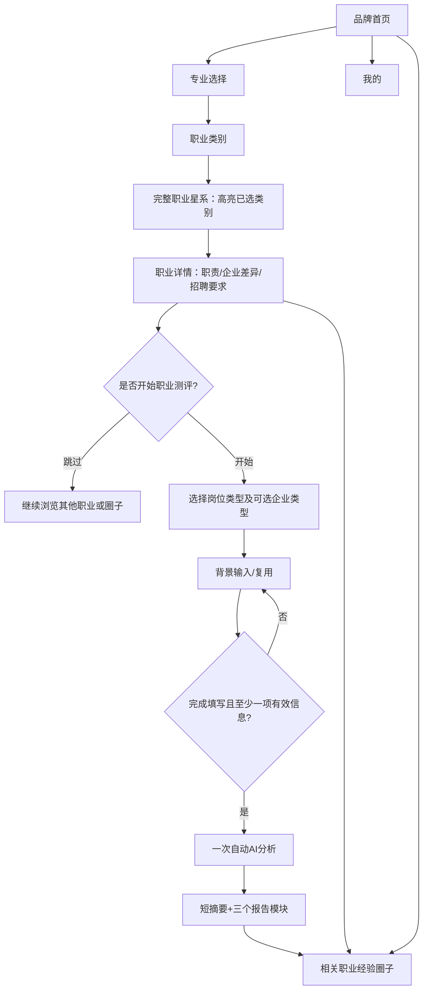
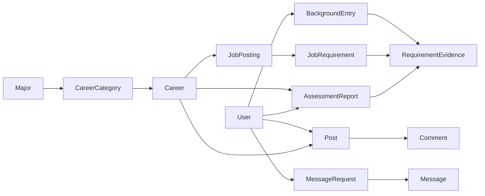
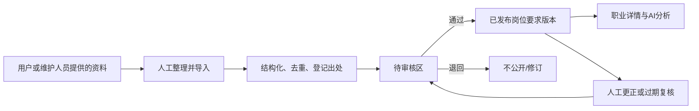

# 去向（QUXIANG）V2.0 产品设计文档

> 文件名：`design-document.md`  
> 状态：产品与交互设计基线；技术实现待现有仓库审计  
> 日期：2026-11-23  
> 依据：[《去向 PRD V2.0》](../docs/去向_PRD_V2.0.md)（2026-11-22）及其后完成的三组设计访谈  
> 目标读者：产品、UI/UX、前后端、数据/AI、内容运营、测试人员及 AI Coding 工具

## 0. 文档边界与决策级别

**确定事项**：本文定义用户体验、页面组织、业务状态、数据关联、权限、异常处理和验收要求。与已确认 PRD 冲突时，以用户最新确认的三组设计决定为准；其余以 PRD 为准。网站必须基于现有工程**增量改版**。

**禁止擅自更改**：不删除其他已有专业；不重绘或替换职业星系为卡片列表；不恢复新闻传播学11个职业的旧选择题；不加入 AI 动画职业形象；不强制用户测评；不把测评与报告拆成两套决策；不把未经审核的招聘资料用于报告；不把证据覆盖率称为能力分数或就业概率。

**尚未核实**：真实技术栈、路由、账号系统、数据库、职业/专业 ID、岗位数据源授权、AI 服务商、部署环境。文中接口名、状态名与数据结构仅为**逻辑契约/设计建议**，不得直接认定其已经存在。

### 0.1 最新确定的增量设计决策

| 范围 | 已确认设计 |
|---|---|
| 先分类再星系 | 选择职业类别后，星系仍显示全部11个职业，选中类别节点重点突出，其余弱化但可访问 |
| 背景填写 | 一个页面分为五类结构化输入区域，允许自由描述，任何类别都不强制填写 |
| 分析对象 | **先选岗位类型，再按需细化企业类型**；分析仅依据该范围可用、已审核的招聘数据 |
| 职业详情 | 顶部标签：工作职责 / 企业差异 / 招聘要求；共性要求与可展开的真实招聘样本并存 |
| 圈子 | 职业分类导航 + 综合信息流；经验分享和求助进入不同的发帖表单 |
| 社区身份 | 匿名帖子对公众隐藏作者；公开主页和非匿名帖子可发起私信请求 |
| 我的 | 个人概览 + 背景档案、报告、收藏、帖子、消息等子页面 |
| 登录 | 免登录浏览；执行需登录动作时轻量引导，完成登录返回原上下文 |
| 首页 | **超大标题 + 少量几何装饰 + CTA**，不以3D职业插画拼贴为主 |
| 选择页 | 编辑式文字列表 + 明亮大色块 |
| 报告 | 顶部短摘要 + 三个纵向模块 |
| 样本不足 | 可形成有依据的有限文字分析，但不输出证据覆盖率百分比 |
| 筛选时机 | 职业详情先选分析目标，测评填写页可修改 |
| 适配 | 桌面与移动端完整适配，星系支持触屏等效操作 |

## 1. 产品目标、范围与非目标

### 1.1 核心目标

帮助大学生连续完成：**发现专业可达职业 → 理解真实岗位要求 → 自愿分析已有学习与实践 → 明确具体补充行动 → 查阅真实从业经验**。

### 1.2 范围

- 本轮完整设计新闻传播学的11个职业：记者、编辑、新媒体运营、内容运营、用户运营、产品经理、品牌策划、市场营销、公关、视频编导、文案策划。
- 保留原有其他专业和功能；原始职业 ID 与分类映射不得随意重建。
- 三个一级入口：**职业探索 / 分享圈子 / 我的**；独立品牌首页与它们并存。
- 管理后台单独受权访问，不作为普通用户一级入口。

### 1.3 非目标

就业成功率预测、企业录用保证、自动投递简历、付费课程商城、AI 虚构毕业生经历、招聘数据自动采集、真实资质认证（本版就业身份仅自报未认证）。

## 2. 信息架构与页面地图

| 逻辑页面 | 页面用途 | 核心模块 | 是否要求登录 |
|---|---|---|---|
| HOME | 独立品牌首页 | 「寻找你的职业。」、简洁几何形、核心 CTA、全站导航 | 否 |
| MAJOR | 选择专业 | 编辑式专业列表、色块、选中反馈、返回 | 否 |
| CATEGORY | 选择职业类别 | 分类列表、说明、当前路径 | 否 |
| GALAXY | 职业星系 | 全11方向、类别强调、微闪连线、节点操作 | 否 |
| CAREER | 职业详情 | 职责/企业差异/招聘要求标签、筛选、测评邀请、圈子联动 | 否 |
| BACKGROUND | 个人背景输入 | 目标岗位选择、五类输入、自由补充、完成填写 | 否 |
| REPORT | 职业准备分析 | 短摘要、三个结果模块、来源与计算说明、圈子入口 | 否 |
| COMMUNITY | 分享圈子首页 | 职业分类导航、综合信息流、搜索筛选、发帖 | 浏览否 |
| POST | 帖子详情 | 内容、职业标签、评论回复、收藏、点赞、举报 | 浏览否；互动是 |
| COMPOSE | 发布内容 | 先选择经验或求助，再进入对应表单 | 是 |
| PUBLIC_PROFILE | 公开用户主页 | 用户自愿公开资料、发帖列表、消息请求入口 | 浏览否 |
| MESSAGES | 请求与私信 | 请求/接受/拒绝、会话、屏蔽举报 | 是 |
| MY | 我的主页 | 资料概览与子页面入口 | 账号信息是 |
| MY_BACKGROUND | 我的背景档案 | 五类资料增删改、复用 | 是 |
| MY_REPORTS | 我的报告 | 每个职业最新报告、版本与重做入口 | 是 |
| MY_SAVED | 我的收藏 | 职业与帖子 | 是 |
| MY_POSTS | 我的帖子 | 普通与匿名内容管理 | 是 |
| ADMIN | 管理工作台 | 岗位审核、社区风险、举报、角色、审计 | 管理员 |

以上为**逻辑页面名**而非既定 URL；最终与旧项目路由兼容，必要时使用现有页嵌套子视图。

### 2.1 关键导航路径

### 2.2 导航要求

- 品牌首页与选择专业**必须是不同页面/路由状态**。
- 职业类别决定星系高亮，不限制用户点击其他类别节点；点击非本类别职业时，详情应显示真实目标职业，必要时同步路径提示。
- 从报告、岗位详情和帖子进入社区时，携带可见职业标签作为筛选条件；用户能够随时清空。
- 浏览过程中支持返回上一步、切换职业、进入三个一级入口；登录中断后恢复原意图。

## 3. 视觉设计系统与响应式原则

### 3.1 风格与设计令牌

以**高明度、强对比、留白、编辑式层级**为基础；主要参考色：亮黄 `#FFE45C`、鲜蓝 `#72C7FF`、珊瑚橙 `#FF9278`、浅紫 `#C9B5FF`、薄荷绿 `#A8EBCB`、暖米 `#FFF4DC`、白 `#FFFFFF`、黑 `#111111`。这些是品牌参考色，最终语义配色与对比度须经过设计验收。

- 首页：超大「寻找你的职业。」标题、少量几何装饰、短文案与一个清晰主 CTA；避免堆满功能卡片或3D拼贴。
- 专业/职业类别：编辑式文字列表配大色块，选中状态通过文字、边框/标记和颜色共同表达。
- 职业星系：完全保留既有视觉语言，只增强类别聚焦、触屏/键盘操作及响应式行为。
- 职业详情：信息型页面，通过标签减少纵向堆叠；保留固定可见或就近可见的核心操作。
- 报告：三块逻辑独立的纵向内容，层级清楚，条形图配数字和文本说明；不增加动画人物或新报告维度。
- 社区：信息流与标签过滤清晰、正文可读，不以纯装饰型卡片堆砌。

### 3.2 基础响应式规则

| 页面 | 桌面端 | 手机端 |
|---|---|---|
| 首页 | 标题与几何装饰具有明确主次 | 标题自适应换行，CTA 始终易触达 |
| 选择页 | 大色块与文字列表可分栏 | 单栏列表、可见选中状态 |
| 星系 | 鼠标悬停/点击、路径高亮 | 触点按下选中、弹出可操作职业信息、明确进入详情按钮 |
| 职业详情 | 顶部标签与内容区域 | 标签支持横向滚动或紧凑布局；不要遮挡正文 |
| 输入 | 五类分区在同页，信息可展开 | 单栏分区、保存/完成按钮不被键盘遮挡 |
| 报告 | 可用更宽的文字/图表布局 | 纵向模块、条形图和来源说明不溢出 |
| 社区 | 标签导航 + 信息流，必要时并列辅助筛选 | 标签横滑、单列可读信息流 |

所有页面都应提供键盘焦点、可识别标签、错误提示、图片文字替代与减少动态效果的适配。图表不能只靠颜色传递信息。

## 4. 核心页面设计

### 4.1 HOME / 品牌首页

**内容层级**：顶部导航 → 超大中文标题 → 一句话价值说明 → 「开始探索」主 CTA → 简洁几何装饰。CTA 进入专业选择；首页可直接导航至圈子或我的。不得将专业选择表单、星系或报告嵌入首页使其变成长滚动主流程。

### 4.2 MAJOR / CATEGORY

- 直接使用既有专业和分类数据；逐项校验新闻传播学/汉语言文学映射，修复根本数据关系而非前端遮蔽。
- 选择专业后展示对应职业类别；选中类别进入星系，同时保存 `selectedCategoryId`。
- 无类别或无职业时说明当前数据状态，不复用其他专业内容填空。
- 列表需明确当前选中、返回、继续操作；不能依靠颜色单独表达。

### 4.3 GALAXY / 职业星系

**显示策略**：**全部11个职业节点同时保留**；`selectedCategoryId` 匹配的节点和路径突出，其他节点降低强调但可点选。已确认的微闪、细线连接、悬停聚焦、点击展开继续运行。

- 不应为了类别筛选将未选类别节点彻底隐藏；职业类别仍是信息组织入口，不是访问限制。
- 点击节点时展示职业名称与简短信息，并允许进入详情。键盘聚焦与手机点击/轻触能获得等效信息。
- 页面须根据现有组件审计决定数据绑定和节点布局，不任意重排或更改节点关系。

### 4.4 CAREER / 职业详情

**顶部标签（主信息区）**：`工作职责`、`企业差异`、`招聘要求`。默认展示工作职责；切换标签更换内容主区而不跳转长篇滚动。支持直接打开特定标签的链接或可恢复状态。

- **工作职责**：职业定位、主要任务、常见工作场景、相关能力与作品类型。
- **企业差异**：按企业/组织类型及岗位类型展示工作侧重和典型差异，明确它是审核资料的归纳，不当作所有企业通用结论。
- **招聘要求**：先展示该职业在适用招聘样本中的共性要求；下方是可筛选、可展开的具体企业招聘样本，含企业/岗位、招聘性质（实习/校招/社招）、要求分级、来源、发布日期（如可得）、核实日期、样本状态。
- **测评入口**：可见但不阻塞阅读；显示当前职业和分析筛选范围；有「开始职业测评」与「继续浏览/暂时跳过」。
- **社区关联**：可直接进入该职业相关经验/求助信息流。

**分析范围选择器**：先选适用岗位类型/招聘性质；企业类型为可选的第二级细化。只展示当前职业有实际记录的筛选选项，说明各范围的数据覆盖情况。用户之后在背景填写页仍可修改该选择。

### 4.5 BACKGROUND / 个人背景输入

一个页面中设置五个可展开分区：①大学课程 ②比赛与项目 ③实习与社会实践 ④作品与作品集 ⑤已掌握技能或工具；另外提供自由补充描述。每类允许新增/删除多个条目，名称为主，任务、具体成果、链接等为选填。

- 顶部固定展示当前职业、已选岗位类型及可选企业类型；点击可修改。修改后对应样本范围同步重新核验。
- 任一分区均可跳过；五类无统一必填要求，但**完成填写时至少有一项有效课程、技能或经历**。
- 进入测评只是进入这一流程；用户随时退出均不触发 AI。
- 访客本地暂存草稿；登录用户可复用并修改个人档案，退出页面不自动重跑分析。
- **「完成填写」**是结束编辑的动作：校验有效输入后**自动发起一次**报告生成；不额外弹出“是否生成报告”确认，也不在输入每个字时调用 AI。
- 分析请求展示进度，防重复发起；失败显示真实错误和重试。

### 4.6 REPORT / 职业准备报告

**抬头**：职业名称、岗位/企业筛选范围、资料来源基准时间、短摘要、证据不足提示（如适用）。后续仅有以下三个纵向模块：

1. **大学知识与经历迁移**：以课程/竞赛/项目/实习/作品/技能条目为起点，说明对应的学习或实践基础、可迁移到的具体岗位任务、解释依据与不确定性。学过某门课不能被视为直接精通技能。
2. **岗位要求与补充学习**：以目标范围内的真实岗位要求为起点，说明尚需补充的知识/工具/实践/作品、为何重要、对应招聘来源与可执行准备方法。优先展示3—5项，其他要求可展开；区分硬性、优先、建议条件。
3. **职业准备概览**：各准备类别的横向**加权证据覆盖率百分比**，附计算说明及三条具体优先行动建议。三条建议来自模块二，不应重复、泛化。数据不足时，百分比位置显示**“岗位依据不足，暂不计算”**，仍可列有来源的文字性准备建议；不以0%或假数值代替。

底部可提供「去圈子看看吧～」及返回职业详情/重新测评；CTA 不构成第四个结果模块。

### 4.7 COMMUNITY / 分享圈子

- **页面结构**：职业分类导航（全部+本轮11职业）→ 关键词搜索与内容类型筛选 → 综合信息流（经验帖/求助帖）→ 发帖入口。
- **发布**：先选择「经验分享」或「求助提问」，再进入相应表单；在校生发布求助、已就业分享者发布经验，角色由登录账号权限决定，不允许切换帖子类型绕过角色。
- **内容**：标题、正文、一个或多个职业标签、可选图片/链接、公开/匿名状态、发布时间、互动数据。
- **匿名**：发表时用户可自行勾选；对公众不显示姓名、昵称、个人主页/公开作者 ID 或私信入口；本人仍可在「我的帖子」管理，后台仅授权人员能够关联真实作者。
- **私信入口**：公开个人主页和非匿名帖子显示「发消息」；先进入**陌生人消息请求**，接受后才能持续私信；匿名帖子不允许直连作者。
- **互动**：评论与回复、点赞、收藏、举报、搜索筛选；游客可读，写入操作弹出轻量登录引导并在登录后恢复原操作上下文。
- **身份标注**：就业情况由本人自报，清晰显示“未认证”；不推断已完成真实就业核验。
- **审核**：先发后审，自动风险过滤、举报队列和管理员处置并行；高风险内容可先拦截/隐藏后复核。

### 4.8 MY / 个人中心

个人概览页链接以下子页面：

- **背景档案**：五类个人资料及自由描述，支持编辑/删除、跨职业复用。
- **职业报告**：每个职业保留最新一份；显示分析岗位/企业范围、生成日期与样本基准版本；重新测评可替换该职业上一份报告。
- **收藏**：职业、社区帖子；可取消收藏。
- **帖子**：本人普通/匿名内容及评论管理，匿名身份仅本人和授权后台可见。
- **消息**：收到和发出的消息请求、已接受会话、拒绝/屏蔽/举报。
- **账号/隐私**：公开昵称、身份自报与未认证状态、个人资料可见范围、退出与删除/注销入口。

未登录进入「我的」时展示清晰的登录引导；访客仍可回到职业探索，不弹出全站强制登录墙。

## 5. 职业分析目标、招聘样本与数据判定

### 5.1 分析范围模型

一次分析至少关联：

`目标职业 ID + 所选岗位类型/招聘性质 + 可选企业类型 + 已审核招聘要求样本版本 + 用户背景版本 + 算法版本`。

- **第一层：岗位类型**。例如编辑、运营、产品等职位内部不同岗位方向，及实习/校招/社招等招聘性质；实际可选项应来自当前职业真实招聘记录，不能凭空创造筛选值。
- **第二层：企业类型（可选）**。例如互联网企业、媒体机构、品牌方等，具体分类从已审核组织类型数据生成。
- 筛选采取逐层细化，不以混合所有岗位的宽泛汇总覆盖用户明确选择的目标；切换选择后解释报告数据范围将发生变化。
- 保留用户先前筛选作为输入状态，但更改筛选不自动调用 AI，仍由用户完成当前测评输入流程后统一生成。

### 5.2 样本充分性与回退

- 只允许**已审核、可追溯、处于分析可用状态**的岗位要求进入统计与报告依据。
- 当筛选结果可用岗位要求不足，允许生成**明确标注范围与局限**的文字迁移/补充分析；不可凭空给出百分比。
- 当几乎没有可用岗位要求时，须直说无法做可靠岗位对照；可解释用户已输入的经历，但不能伪造与企业要求的关联，可提供切换筛选范围建议。
- 用户可自行改选其他岗位或企业类型；**不得静默扩大筛选范围**或引用其他职业数据充当当前职业。
- “足够样本”不能仅凭条数武断判断，应核实样本去重、招聘性质一致性、企业多样性及要求覆盖；具体数值阈值属于数据审计后确认的实施参数。

### 5.3 招聘资料的两层展示

1. **共性职业要求**：按选定范围归并同义要求，归类为任务、技能工具、作品实践、资格条件，并区分必要/优先/建议；每一条可点开查看对应原始岗位。
2. **真实招聘样本**：可展开的公司/岗位卡片，保留原始来源链接、时间、样本类别、审核状态和是否仍在招聘的事实边界。

区分历史招聘样本与当前可申请岗位。企业官网与招聘平台均可作为候选来源，但来源可用性必须依法规、平台规则及授权条件逐一核查。

## 6. 加权证据覆盖率与解释设计

### 6.1 计算对象

计算目标不是能力水平，而是：**用户已经填写的经历证据对选定岗位范围要求的覆盖程度**。同一职业换企业/岗位筛选范围时，应重新定义要求集合及其分母。

对去重后的每项要求 `r`：

- 重要性权重 `w_r`：必要 / 优先 / 一般建议。PRD 中 `3 / 2 / 1` 为**待验证的默认建议**，不是已签字确认的固定值。
- 证据系数 `e_r`：直接相关且有具体可解释证据 / 部分间接关联 / 尚无提供证据。PRD 中 `1 / 0.5 / 0` 同样属于**待验证默认建议**。

某类别覆盖率：

`coverage(category) = round(100 × Σ(w_r × e_r) / Σ(w_r))`

仅对当前类别、当前筛选范围内可用且已审核的要求计算；若分母为空或证据不足以合理汇总，则不显示百分比。

### 6.2 计算职责与可追溯性

- AI 负责理解课程/经历、提出潜在对应项和理由，输出引用的要求 ID 与背景条目 ID；**不能直接自由生成覆盖率数字**。
- 确定性业务逻辑核对要求 ID、权重与证据系数并计算百分比。
- 报告提供「为什么得到这个百分比？」入口，能展示每项要求、证据对应、权重、来源与计算版本。
- 用户只填一门课也可生成有明确限制的报告，但低证据覆盖率**不等于**低技能或较低的被录用概率。
- 同一人修改背景、切换岗位范围、招聘数据库版本变化后，新报告应记录新的基准，不与旧版本混淆。

## 7. 逻辑数据模型（不预设数据库）

| 逻辑实体 | 必要信息/关系 |
|---|---|
| Major / CareerCategory / Career | 原有 ID、分类关系、展示名称及职业星系节点绑定 |
| JobSource | 资料批次、出处、证据等级、导入时间 |
| JobPosting | 职业、岗位类型、招聘性质、企业与企业类型、原始链接、发布时间、导入时间、审核时间、当前状态、版本 |
| JobRequirement | 对应招聘样本、结构化要求、类别、重要性、原始引用位置、审核状态 |
| User / Profile | 账号身份、社区角色、公开资料、隐私偏好、受控权限 |
| BackgroundEntry | 用户、经历类型、名称、选填详情、背景版本 |
| AssessmentReport | 用户或临时访客标识、职业、筛选条件、岗位数据版本、背景版本、算法版本、三个模块、生成时间 |
| RequirementEvidence | 报告、岗位要求、个人背景条目、证据级别、解释及来源 |
| Post / Comment | 经验/求助类型、作者、匿名位、职业标签、公开与审核状态 |
| Reaction / Bookmark | 用户、目标对象、动作、去重约束 |
| MessageRequest / Message | 请求人、接收人、状态、会话权限、屏蔽与举报关联 |
| Moderation / Audit | 内容或数据审核对象、动作、处理人、时间、原因 |

真实数据库需经过存量 schema 审查再确定字段命名、索引、迁移及历史兼容方案；不得因概念模型不同而直接删表重建。

## 8. 系统模块边界与逻辑接口

### 8.1 模块职责

| 逻辑模块 | 责任 | 核心约束 |
|---|---|---|
| 专业职业目录 | 既有专业、类别、职业关系与星系节点数据 | 不改变已有职业和专业含义；防止跨专业映射 |
| 招聘资料导入 | 接收人工提供的资料，结构化、去重并检测变化 | 导入结果先入候选区，审核后发布 |
| 招聘审核服务 | 审核、发布、版本化、失效与来源管理 | 仅审核通过的数据用于前台与 AI |
| 个人档案 | 五类背景的暂存、同步、编辑和删除 | 未登录本地暂存；登录后按用户授权同步 |
| AI 分析编排 | 读取职业筛选和已审核要求，调用真实 AI，校验引用与结构 | 失败不能伪装成功；不泄露密钥或非必要个人信息 |
| 覆盖率引擎 | 使用审核要求、证据映射与权重确定性计算 | 保留分母、规则版本和引用；数据不足不计算 |
| 社区内容 | 经验/求助发帖、评论、互动、搜索 | 角色控制、匿名隔离、风险识别 |
| 消息与请求 | 陌生人请求、接受、会话、屏蔽和举报 | 未接受不得持续私信，匿名帖不能反查作者 |
| 个人中心 | 报告最新版本、收藏、帖子、消息及隐私 | 用户仅能访问本人私有数据 |
| 管理后台 | 招聘审核、社区举报、风控、权限与审计 | 管理操作服务端授权、留痕 |

### 8.2 关键逻辑操作（非固定 API URL）

| 操作名 | 输入 | 输出及行为 |
|---|---|---|
| `listMajorsAndCategories` | 现有目录上下文 | 专业/职业类别/职业关系；只读 |
| `getGalaxyView` | 专业、类别 ID | 全量有效职业节点及 `highlighted` 状态 |
| `getCareerDetail` | 职业 ID、选中标签和可选筛选 | 工作职责、企业差异、已发布招聘要求与可追溯来源 |
| `getAnalysisScopes` | 职业 ID | 有有效记录的岗位类型、可选企业类型、样本情况 |
| `saveBackgroundDraft` | 五类条目、自由描述、会话身份 | 本地暂存或账号档案更新；不自动分析 |
| `finishAssessment` | 职业、筛选、背景、幂等键 | 校验→触发一次真实分析→状态和报告结果；失败可重试 |
| `getLatestReports` | 当前账号 | 每个职业最新一份报告、范围与数据版本 |
| `listPosts` | 职业、关键词、类型、分页 | 仅可公开帖子，作者匿名策略生效 |
| `publishPost` | 账号、角色、帖子类型、正文、匿名设置 | 内容安全检查、发布/拦截/审核状态 |
| `requestMessage` | 发起者、目标公开用户 | 请求状态；未接受不能发持续会话消息 |
| `reviewJobPosting` | 管理员、候选岗位、审核决定 | 发布版本变化及审计记录 |

鉴权、数据隔离、幂等和状态验证必须在服务端；客户端隐藏按钮不等于授权控制。

## 9. 重要业务状态与异常处理

### 9.1 职业测评状态机

`idle → editing → validating → analyzing → success | failed | insufficient_job_data`

- `idle`：仅浏览职业，不调用 AI；`editing`：可离开、暂存；`validating`：检查目标、筛选和一项有效输入。
- `analyzing`：仅一次有效分析任务，禁止重复提交；`success`：展示三个结果模块。
- `failed`：明确失败原因与重试；不得展示模板化假报告。
- `insufficient_job_data`：展示具体不足事实和可支持的有限文字分析，无百分比，并允许返回调整筛选条件。

### 9.2 需要覆盖的异常

| 场景 | 预期行为 |
|---|---|
| 无效职业或切换到其他专业 | 不串职业数据；展示路径提示并保留用户合法草稿 |
| 未选择有效岗位范围 | 引导先选岗位类型；不使用所有岗位静默代替 |
| 背景为空/无意义 | 提示填写至少一项有效信息；不调用 AI |
| 分析过程中离开 | 有清晰状态与结果恢复机制；不可重复扣费/生成多个报告 |
| AI 超时、返回引用无效或请求失败 | 显示真实错误、可重试，不保存虚假结果 |
| 招聘样本不足 | 有限文字分析、无百分比，建议用户自主变更范围 |
| 招聘状态后来过期 | 已发布历史数据标注时间，不标记仍在招聘 |
| 访客尝试收藏/发帖/评论/私信 | 轻量登录引导并保留用户动作上下文 |
| 匿名帖 | 公共接口不暴露作者 ID、公开资料、可反向查找地址 |
| 私信请求未接受 | 仅允许请求相关操作，不开放持续消息发送 |
| 职业资料或访客浏览器数据被删除 | 不声称可恢复；清晰提示并执行相应失效处理 |
| 人工批次缺少字段或出处记录 | 退回修订，保留已有发布版本 |

## 10. 账号、隐私、社区安全

- **访客**可以浏览与进行临时职业分析；账号持久存储需登录并由用户选择同步。
- 公开社区身份与用户的**私有背景档案/报告**分离；报告、个人经历及私信不得默认公开。
- 在校生、已就业分享者为用户声明的社区角色；就业状态显示**未认证**，不展示虚假的平台认证。
- 帖子匿名时，对普通用户隐藏作者资料及可反查标识；管理员需受控审查权限，记录访问原因和审计。
- 私信：陌生人请求→对方接受→聊天；支持拒绝、屏蔽、举报和限频。用户不能借匿名帖获得匿名作者联系信息。
- 社区以先发布后审核为主；风险识别对高风险内容可先拦截，配合举报与人工审核；管理员操作留痕并提供反馈/申诉路径。
- AI 请求数据最小化，服务端存储密钥，禁止在客户端和普通错误日志暴露个人信息；实施内容上传限制、链接安全检查、身份鉴权、数据删除规则。

## 11. 招聘资料人工维护与治理

- 招聘资料由用户或维护人员按需提供，保留已知的出处和证据等级。本版采用人工维护方式。
- 每条记录保留导入时间、岗位发布时间（可得时）、出处和审核状态，区分校招、实习、社招。
- 新增/修改/失效均经审核后才改变对外数据版本；导入或审核失败时保留上一版已发布资料并标明时效。
- 此次用户提供的资料无需独立验证来源。通用要求仍应有资料出处，归纳内容经审核后发布。

## 12. 设计验收与测试对应关系

在 PRD 的 AT-01～AT-21 基础上，增加以下**设计专项检查**，不替代原验收：

| 编号 | 验收场景 | 必须满足 |
|---|---|---|
| D-01 | 首页 | 独立超大标题 + 几何装饰 + CTA；不与专业选择合成一页 |
| D-02 | 专业与类别页 | 编辑式文字列表、大色块、明确选中和返回 |
| D-03 | 星系 | 选中类别高亮，其他11职业节点仍可见可点；原动效保留 |
| D-04 | 详情标签 | 工作职责/企业差异/招聘要求切换正常；上下文筛选不丢失 |
| D-05 | 招聘信息 | 共性要求和可展开真实记录并存，每条可追溯 |
| D-06 | 分析目标 | 先岗位类型、再可选企业类型；可从填写页更改 |
| D-07 | 测评输入 | 同页五类分区；一项有效信息即可完成；不在编辑中途触发 AI |
| D-08 | 报告 | 短摘要+三纵向模块；无多余评分或动画画像 |
| D-09 | 范围不足 | 有依据的有限文字内容；百分比明确不可计算 |
| D-10 | 圈子 | 职业分类导航+综合信息流；经验/求助分别编辑 |
| D-11 | 匿名与私信 | 匿名作者不暴露；非匿名帖子和公开主页可发请求 |
| D-12 | 我的 | 个人概览及五类子页面；按职业仅最新报告 |
| D-13 | 登录恢复 | 访客阅读不受限；需登录时引导并返回原操作 |
| D-14 | 响应式 | 桌面与手机完整完成关键流程，星系触屏操作有效 |
| D-15 | 完整安全验收 | 权限、内容治理、招聘数据审核、数据隔离与端到端流程通过 |

测试数据需覆盖：单项课程、完全无实习、跨企业类型差异、某筛选范围几乎无岗位、AI 错误、匿名举报、私信请求被拒绝、登录后访客草稿同步、原有其他专业回归。

## 13. 实施顺序与代码审计清单

1. **仓库审计**：读取现有文件树、技术栈、路由、星系、专业数据映射、登录与数据持久化，标记“保留/调整/新增/待核实”；建立备份与回滚基线。
2. **信息模型和招聘数据**：核实11职业及原有其他专业的 ID 映射，确定岗位类型、企业类型、审核、来源和版本机制。
3. **导航与页面设计落地**：独立首页、文字列表选择页、星系类别聚焦、详情顶部标签、招聘共性要求+样本。
4. **个人背景和分析**：五类输入、选岗细分、真实 AI、可追溯证据映射、确定性权重计算、有限分析、最新报告保存。
5. **社区及账号**：信息流、发帖类型、匿名、互动、用户主页、消息请求、个人中心。
6. **后台及安全**：岗位审查、社区举报处置、权限/隐私、审计日志、人工资料维护。
7. **完整验收**：按 PRD 与本文联合测试；尤其检查原有其他专业及星系没有回归性问题。

### 13.1 不应擅自设定的实施参数

- 实际组件与路由路径、数据库结构及迁移脚本：待仓库审计。
- 岗位类型/企业类型的具体枚举和各职业对应关系：待真实招聘数据库核实。
- 权重 `3/2/1`、证据系数 `1/0.5/0`、有效样本门槛：PRD 提出的可解释默认建议，需内容与产品验证后版本化。
- 后续招聘资料由维护人员按需补充，记录出处和发布版本。
- 登录提供方、AI 服务商、请求成本与数据处理条款：根据现有项目与可用服务选择。
- 图片/作品上传方式与大小限制、数据保留期、管理后台实现：结合基础设施和安全评估明确。

这些属于**待实施核实项**，不是重新开放已确认的产品范围。

## 14. 交付定义

`design-document.md` 作为**产品设计与逻辑技术方案**，与[《去向 PRD V2.0》](../docs/去向_PRD_V2.0.md)配套使用。实际开发开始前，应输出一份现状审计差异清单；设计仅在审核既有实现后映射到实际组件、路由、表结构和 API。

**成功的用户旅程**：用户无需登录可从独立首页选择专业与职业类别，在保留全部节点的职业星系中查看职业详情和真实岗位资料；可跳过测评，也可选择具体岗位范围后填入至少一项个人背景信息、完成填写并得到有来源的三模块分析；样本不足时获得诚实的有限报告；用户可进入独立职业经验圈子，登录后发布、互动、使用受控私信，并管理自己保存的背景和每个职业最新报告。
