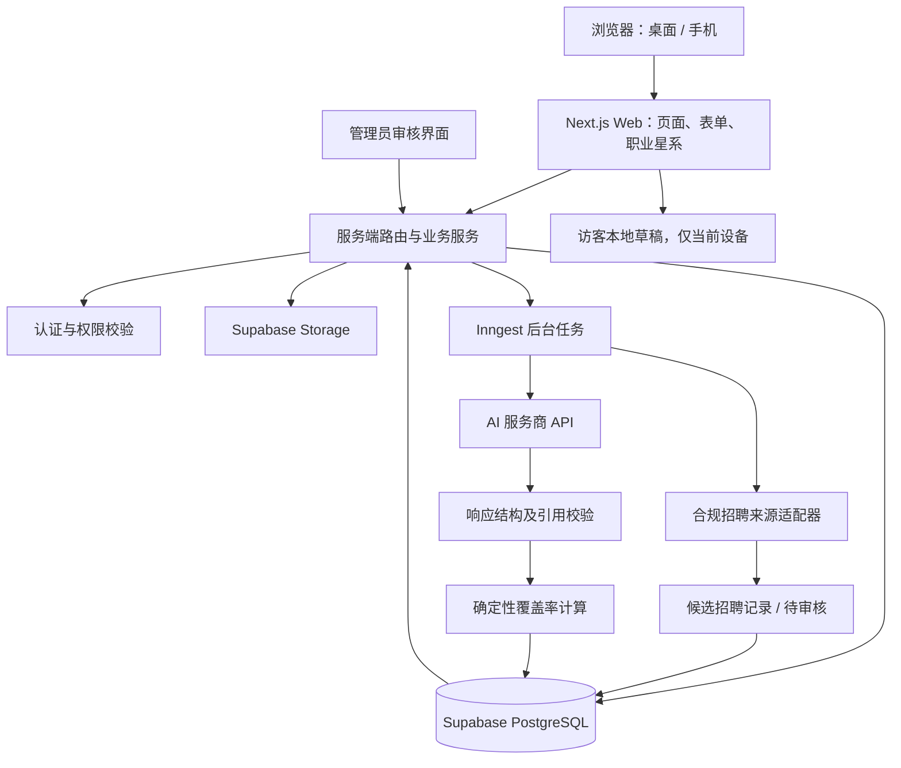

# 去向（QUXIANG）V2.0 技术栈选型

> **文档状态**：推荐方案，待现有仓库审计后确认  
> **制定日期**：2026-11-23  
> **依据**：[产品设计文档](design-document.md)与[《去向 PRD V2.0》](../docs/去向_PRD_V2.0.md)  
> **选型原则**：**增量改版、技术种类少、功能完整、权限可靠、便于 AI Coding 与长期维护**。

## 1. 结论：推荐一套 TypeScript 全栈 + 托管后端

**在现有项目没有明显相反约束的情况下，首选方案是：**

| 位置 | 首选技术 | 用途与选择理由 |
|---|---|---|
| 前端与全栈 Web 框架 | **Next.js（App Router）+ React + TypeScript** | 同一项目实现多页面、服务端数据读取和业务接口，减少前后端分仓与重复类型定义；支持访客浏览、登录页面和管理后台 |
| 页面样式 | **Tailwind CSS + 少量 CSS Modules / CSS 变量** | 快速维护明亮的杂志式视觉；自定义排版和大色块，不强依赖现成卡片模版 |
| 基础组件 | **shadcn/ui + Radix UI（按需引入）** | 表单、标签、弹层、可访问的交互组件；仅使用必要部分，避免 UI 依赖膨胀 |
| 数据库 | **Supabase 托管 PostgreSQL** | 专业职业关系、招聘样本、课程档案、分析报告、帖子、消息和审核记录适合关系型数据库 |
| 身份认证与授权 | **复用现有认证；若没有适配方案，优先 Supabase Auth + PostgreSQL RLS** | 免登录浏览、登录后写入、账号私有信息隔离和角色权限 |
| 文件存储 | **Supabase Storage** | 社区配图及用户主动上传的作品附件；私有/公开存储桶分开 |
| AI 分析 | **服务端模型接口 + Zod 结构化响应校验** | 分析用户课程与经历，引用已审核岗位要求 ID；无效引用必须拒绝或纠正；业务代码计算覆盖率而非让模型编造百分比 |
| 后台任务与定时调度 | **Inngest（推荐）** | 定时采集、重试、去重处理、审核队列同步以及可能耗时的 AI 任务；避免自建 Redis + worker + cron 的整套基础设施 |
| 招聘采集 | **优先官方/授权 API；无 API 时使用合规的 HTTP + HTML 解析适配器** | 企业官网与允许采集的招聘平台分源处理；先入候选区、审核后发布 |
| 表单与校验 | **React Hook Form + Zod** | 五类可增删的个人背景输入；前端交互校验与服务端契约共享 |
| 自动化测试 | **Vitest + React Testing Library + Playwright** | 算法与权限单元测试、组件测试、跨页面端到端验收 |
| 部署 | **优先 Vercel（Web）+ Supabase（数据）+ Inngest（后台任务）** | 小团队部署简单；若现有环境已有同等能力，优先沿用 |

**技术结构一句话：** 一个 Next.js/TypeScript Web 项目，加一个 PostgreSQL 托管数据库，再通过可靠后台任务接入招聘数据与真实 AI。**不建议**初期搭建微服务、Kubernetes、独立 Java/Python API 层或自管 Redis 队列。

> **重要前提**：尚未读取「去向」现有代码。Next.js/Supabase 是**新建或迁移成本合理时的首选**，不是强制推翻已有技术栈。如果现有项目已使用 React + Vite、Vue、其他稳定后端或已上线的身份系统，须先比较迁移风险；只有明确收益大于成本时才迁移。

## 2. 为什么这套方案符合「去向」

`design-document.md` 明确要求：

1. 保留旧专业、原职业 ID 与现有星系组件；本轮重点完善新闻传播学 **11 个职业**。
2. 提供独立首页、专业与类别选择、完整星系、带顶部标签的职业详情、一个页面五类背景输入和三模块报告。
3. 允许**访客浏览、访客临时测评**；登录后管理私有背景、每职业最新报告及社区内容。
4. 真实招聘信息须**定期采集 → 清洗去重 → 人工审核 → 发布版本**，未经审核不得进入 AI 分析。
5. AI 只负责识别、解释和证据映射，**百分比由确定性规则计算**；样本不足只输出有限文字，不造数值。
6. 社区具备身份角色、匿名帖子、审核、搜索、点赞收藏、消息请求及私信；个人隐私不能被公开 API 泄漏。

上述需求包含大量关系型数据、严格的权限边界和可追溯的后台流程。PostgreSQL + 受控服务端逻辑比以浏览器本地状态或纯静态 JSON 充当后端更适合。Supabase 已集成数据库、认证、文件存储及可选实时功能，可减少多个独立厂商之间的拼接成本。

## 3. 推荐系统架构



**单体优先，模块隔离**：Web 与业务 API 可在同一仓库，但按“职业目录 / 招聘数据 / 分析 / 社区 / 私信 / 管理后台”划分目录和服务函数。外部服务不应直接决定产品业务规则。

## 4. 各模块落地建议

### 4.1 职业探索与视觉

- **Next.js + React** 承担页面路由及数据展示，原有职业星系组件应原样复用并补充所选类别高亮、触屏和键盘操作。
- **Tailwind CSS** 管理布局、响应式和品牌色令牌；推荐以 CSS 变量管理亮黄、鲜蓝、浅紫、黑白等设计值。
- 首页以超大标题、几何元素、CTA 为主；选择页采用编辑式文字列表与大色块；职业详情使用可访问的 Tabs。
- 星系交互继续沿用现有图形技术（SVG、Canvas、D3 或其他）。**不因为选择 Next.js 就将星系重写为新图库**。
- 复杂图表库不是必需：报告的横向覆盖率状态条用普通组件和 CSS 即可完成，并提供文字解释、来源和计算依据。

### 4.2 职业目录和招聘数据库

- 以 **PostgreSQL** 保存 `major`、`career_category`、`career`、映射关系、`job_source`、`job_posting`、`job_requirement` 等逻辑数据。
- 将旧职业 ID 与分类映射作为迁移约束；对新闻传播学和汉语言文学曾出现的映射重复做回归测试。
- 招聘表明确区分 `collected_at`、`published_at`、`verified_at`、`review_status`、`posting_status`、`data_version` 等信息。
- 原始抓取数据先进入**候选/隔离层**；只有经授权管理员审核并发布的要求，才能成为职业详情或 AI 的权威依据。
- 按真实数据构建岗位类型→可选企业类型筛选；没有足够来源时显示范围不足，不自动扩展到其他岗位。
- 搜索起步采用 PostgreSQL 索引与全文搜索能力；**不要一开始引入 Elasticsearch 或独立向量数据库**。

### 4.3 招聘数据自动采集

- 使用 **Inngest 定时任务**触发不同来源的采集适配器；每个来源单独记录授权状态、抓取方式、检查周期和失败原因。
- 优先合作数据、官方 API、开放接口或允许使用的公开页面；普通静态页面可用 `fetch` + HTML 解析器（如 Cheerio）。
- 遇到需要认证、限制访问、反自动化验证或不允许采集的平台，应**跳过并记录不可用原因**，不得绕过限制。
- 仅在确有许可且页面必须渲染时，才评估独立浏览器自动化执行环境；不把 Playwright 抓取作为默认方案。
- 采集流程为：获取 → 解析 → 标准化 → 去重 → 变化比较 → 待审核 → 人工发布/回退 → 过期检查。
- 不建议将长期采集任务塞进一次普通 Web 请求；任务应可重试、幂等、记录进度，避免超时与重复导入。
- **补充要求**：AI 生成的招聘要求摘要也必须链接已审核原始记录，不能成为独立的无来源事实。

### 4.4 个人背景与 AI 分析

- React Hook Form + Zod 管理五类背景信息的动态输入条目和可选描述；至少一项有效资料后，用户点击**「完成填写」**才触发一次分析。
- 未登录用户草稿保存在浏览器本地（不包含服务端密钥）；提醒用户本地草稿可能丢失，建议尽量减小敏感信息保存量。用户登录后明确选择是否同步。
- 在服务端获取已审核岗位要求，**只把当前职业、已选岗位/企业范围与最少必要用户背景**发送到 AI；密钥只存在服务端。
- 用 **Zod** 验证 AI 输出的结构，包括 `job_requirement_id`、`background_entry_id`、关联理由、证据档位、补充项、建议等；不存在的 ID 或未经审核的数据不得进入计算。
- 覆盖率在业务层计算：`round(100 × Σ(要求权重 × 证据系数) / Σ要求权重)`；当前设计中的 `3/2/1` 与 `1/0.5/0` 为**待确认默认参数**，不能直接宣称科学有效。
- 无充足岗位资料时仅生成可追溯的有限文字结论，**不返回百分比**。AI 失败返回真实错误与可重试状态，不返回假报告。
- 为请求设置幂等键、状态及重试；持久化用户+职业最新报告，同时记录输入版本、岗位资料版本与算法版本。

### 4.5 账号、权限与隐私

- **先审计已有身份系统**。只有当前系统不适合或不存在时，才采用 Supabase Auth。
- 在校生、已就业分享者为**自报的社区角色**；管理员由后台授权，不得靠前端修改个人资料获得。
- PostgreSQL **Row Level Security（RLS）** 配合服务端权限检查：用户只读写自己的背景、报告、私信、收藏和本人内容；公开帖子返回经过匿名脱敏的字段。
- **匿名发帖不能简单地把作者字段隐藏于 React 组件**：应从公开数据读取层就去除作者 ID、账号关联和个人资料；仅授权管理端与本人管理入口可访问受限关联。
- 作品附件/图片区分公开和私有存储桶，使用权限检查和必要的限时访问链接。
- 账号删除、隐私告知、AI 第三方数据处理、私信举报审查、日志脱敏等纳入实现与测试；不要把隐私合规寄托于某个 SDK 的默认设置。

### 4.6 分享圈子、私信和后台

- 社区采用 PostgreSQL 关系表保存帖子、评论、反应、收藏、职业标签、举报及审核动作；先用数据库分页与索引支持综合信息流。
- 角色决定可发帖子类型：在校生发求助帖；已就业分享者发经验帖；自报就业身份统一标明**未认证**。
- 发布内容首先通过基础校验与风险过滤；普通内容先发布后审，高风险拦截待人工复核。管理员具备审核、隐藏、恢复、删除与审计功能。
- 陌生人先发送消息请求，对方接受后才可持续私信；服务端校验请求/会话状态，提供屏蔽、举报、频率限制。
- **实时聊天不是首期的必要基础设施**：可先用常规消息接口 + 适度刷新满足功能；若确需低延迟消息体验，再启用 Supabase Realtime，并落实私有频道授权。
- 不引入单独论坛系统、即时通讯服务器或独立搜索服务，除非使用数据证明这些设施确有必要。

## 5. 技术依赖与取舍

| 技术 | 建议 | 原因 |
|---|---|---|
| TypeScript | **采用** | 前后端共享类型、AI 输出结构更容易校验 |
| Next.js | **条件推荐** | 适合多页面全栈；若已有框架成熟，先比较迁移成本 |
| Supabase | **条件推荐** | 提供 PostgreSQL、Auth、Storage、可选 Realtime，减少平台数量 |
| Tailwind CSS | **优先采用或保留已有方案** | 快速构建响应式和视觉变量 |
| shadcn/ui / Radix | **按需** | 优先复用现有组件，避免大量重写 |
| Inngest | **推荐给定时采集和耗时任务** | 简化调度、重试、任务状态；需核实套餐、运行区域与调用成本 |
| Zod / React Hook Form | **推荐** | 动态表单、输入与 AI 输出校验 |
| Supabase Realtime | **按需** | 私信先实现正确权限和消息请求，再考虑实时体验 |
| Drizzle / Prisma | **二选一或沿用现有，不同时引入** | 项目已有数据库访问层时不需要重写；若使用 Supabase SDK + SQL 已够用，不必强加 ORM |
| 独立 Python FastAPI 服务 | **暂不采用** | 增加部署和接口维护负担；只有合规采集需复杂 Python 生态时才单独引入 |
| Redis、RabbitMQ、Kafka | **暂不采用** | 初期 Inngest + PostgreSQL 足够支持任务与状态管理 |
| Elasticsearch / 向量数据库 | **暂不采用** | 11个职业与首期社区规模，数据库检索更简单；有实测瓶颈再扩展 |
| Kubernetes / 微服务 | **不采用** | 当前项目复杂度和团队规模不需要 |

## 6. 项目目录建议（仅在新建 Next.js / 迁移确认后使用）

```text
src/
├── app/                    # 页面与路由：探索 / 报告 / 圈子 / 我的 / 管理
├── components/             # 可访问通用组件、原星系适配层、图表
├── features/
│   ├── careers/            # 专业、类别、职业详情
│   ├── jobs/               # 来源、岗位样本、审核与发布
│   ├── assessment/         # 背景输入、AI 编排、覆盖率、报告
│   ├── community/          # 帖子、评论、举报、匿名
│   ├── messaging/          # 消息请求与会话
│   └── profile/            # 用户背景、收藏和报告索引
├── server/                 # 服务端权限、数据库、AI 服务商适配器
├── jobs/                   # 定时采集、后续处理与可重试任务
├── lib/                    # Zod schemas、通用工具、配置
└── tests/                  # 单元、集成与 E2E 测试
```

此目录**不是对现有网站的真实描述**。审计代码后应优先复用现有路径及星系组件，避免为了匹配模板大规模重排。

## 7. 部署、运维与成本控制

**推荐部署组合（条件成立时）**：

- **Vercel**：部署 Next.js 前端与业务 API。
- **Supabase**：托管 PostgreSQL、登录与附件；数据访问由 RLS 与服务端权限双重约束。
- **Inngest**：执行定时采集、重试、阶段性数据处理和部分耗时 AI 任务。
- **AI 服务商**：通过统一服务端适配层访问，不在产品业务层写死模型或密钥。

成本主要取决于：**AI 调用量、招聘采集频率、图片附件存储量、数据库和聊天流量**。开发前检查套餐限制、请求超时、执行区域和数据处理条款；本文不承诺固定价格或免费额度。

最简单的成本控制措施：岗位数据缓存与版本化、用户一次完成填写才触发一次分析、重复请求幂等、采集只处理发生变化的岗位、文件大小与上传频率限制。

必要运维：环境变量管理、数据库备份与恢复测试、错误监控、任务失败告警、管理员审计日志、数据迁移回滚计划。可以先用平台内置日志和告警，监控不足时再接入 Sentry 等工具。

## 8. 测试和验收工具

- **Vitest**：覆盖岗位权重加权算法、证据系数、版本一致性、数据去重与角色判断。
- **React Testing Library**：检查动态五类表单、职业详情标签、登录引导、消息请求状态。
- **Playwright**：运行核心端到端流程，包括“首页→专业→类别→完整星系→职业详情→自愿测评→三模块报告→圈子→我的”。
- **数据库权限测试**：验证普通用户无法访问他人报告/私信；匿名帖公共查询不泄露作者关联；未审核岗位无法被 AI 检索。
- **失败路径测试**：招聘样本不足、AI 请求失败、采集来源不可用、重复提交、访客本地暂存、登录后同步、私信拒绝与屏蔽。
- **移动端与键盘测试**：检查星系触屏替代行为、Tabs、动态表单及减少动态效果设置。

每一项均需对照[产品设计文档](design-document.md)及[《去向 PRD V2.0》](../docs/去向_PRD_V2.0.md)中的验收基线，不以“页面能打开”代替真实功能验收。

## 9. 启动开发前的决策门槛

**先审计现有仓库，未审计前不启动大规模重构。** 最低需要核实：

1. 已有前端框架、语言、路由、CSS / 动效库及职业星系实现方式；能否直接延续。
2. 数据持久化方式、现有专业/职业 ID、账号登录及数据库访问规则；是否已有成熟后端。
3. 可用的招聘来源、接口许可及自动更新边界；是否具备审核岗位的管理员流程。
4. 已有部署环境、托管服务、环境变量及 AI 服务接口。
5. 团队能否承担 Next.js + Supabase + Inngest 的运行与维护；当前已有组件是否更简洁。

### 决策树

- **若现有项目已经是 React/Next.js + PostgreSQL/Supabase**：优先保持原栈，仅补齐缺失功能；不要为了版本统一而重建。
- **若现有项目是 React + Vite，已有稳定 API/认证/数据库**：保留 Vite + 现有后端，增加需要的业务模块；**不要仅为采用 Next.js 迁移整个站点**。
- **若现有项目仅有静态前端、无正式后端**：采用本文首选的 Next.js + Supabase + Inngest 组合通常具有较低的整体集成成本。
- **若现有项目使用 Vue 或其他稳定框架**：维持其组件与路由；仍可复用 PostgreSQL、可追溯 AI 分析、合规采集和任务编排的核心思路。

**确定迁移前必须提交：现状技术清单 → 保留/新增/替换差异表 → 风险与回滚方案 → 技术选型确认。**

## 10. 官方参考资料（2026-11-23 核对）

- Next.js App Router：https://nextjs.org/docs/app
- Next.js 服务端业务接口：https://nextjs.org/docs/app/guides/backend-for-frontend
- Supabase Docs（数据库、Auth、Storage）：https://supabase.com/docs
- Supabase PostgreSQL RLS：https://supabase.com/docs/guides/database/postgres/row-level-security
- Supabase Realtime：https://supabase.com/docs/guides/realtime/subscribing-to-database-changes
- Inngest Next.js 与可靠任务：https://www.inngest.com/docs/getting-started/nextjs-quick-start
- Inngest 定时任务：https://www.inngest.com/docs/durable-execution/guides-and-advanced/events-and-triggers/schedules-and-delayed-starts
- Playwright：https://playwright.dev/docs/intro

---

**最终建议**：将 **Next.js + TypeScript + Tailwind CSS + Supabase PostgreSQL/Auth/Storage + Inngest + 服务端 AI 接口 + Zod + Playwright** 作为「去向」的**首选技术架构**；但实际施工以仓库审计为前提，**保留现有成熟栈、职业星系和旧数据，优先增量实现，而不是推倒重来**。
